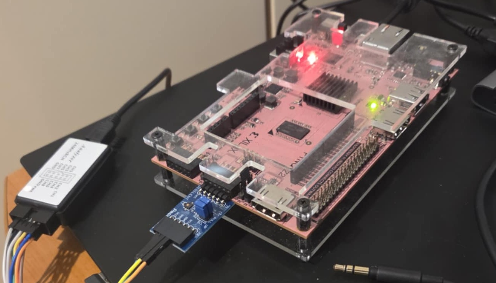
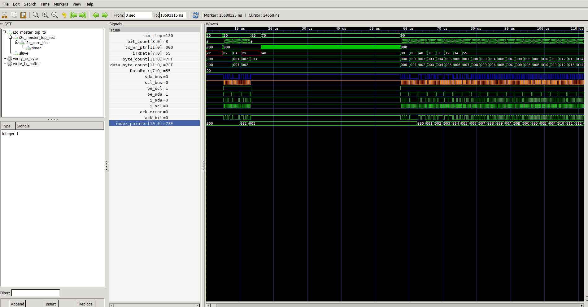
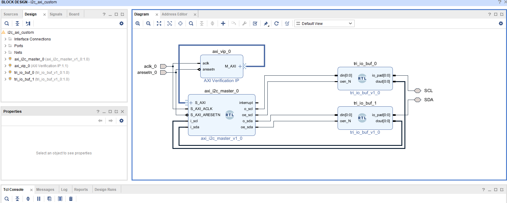
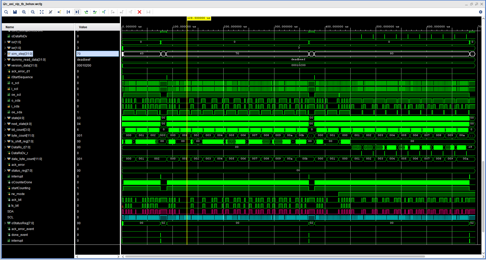
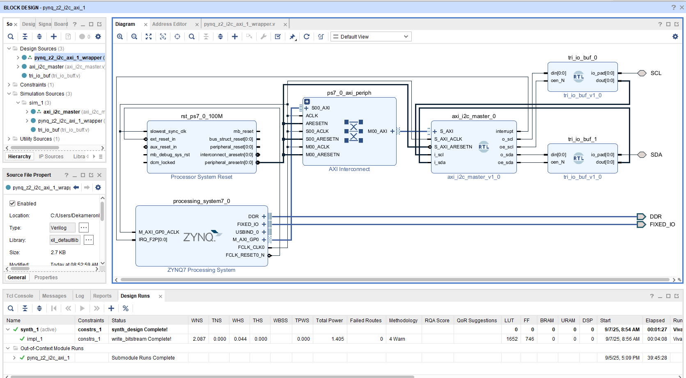
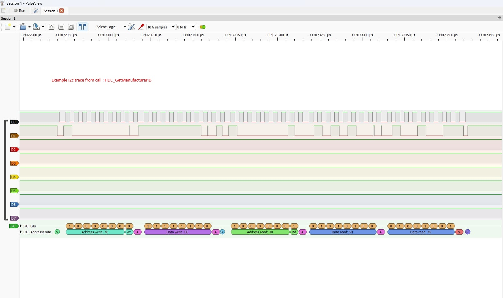
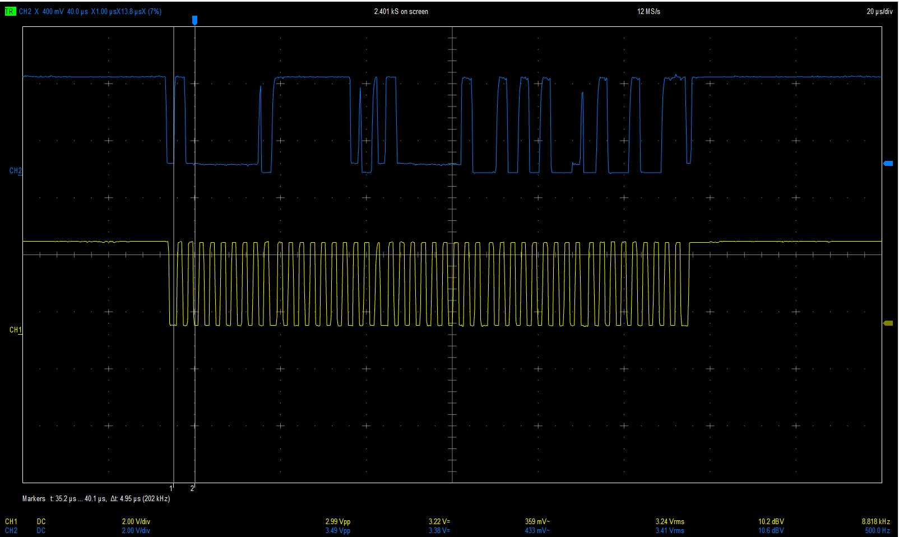

# Zynq AXI I2C Master IP Core

This project provides a complete solution for I2C communication on Zynq-based systems, featuring a synthesizable AXI I2C Master IP core (PL) and a comprehensive embedded software driver for the Processing System (PS).

## Features

- AXI4-Lite slave interface for register access.
- Supports 100 kHz, 400 kHz, and 1 MHz I2C speeds.
- Core I2C logic for Write, Read, and combined Write-then-Read operations.
- Software-resettable core for improved fault recovery.
- Level-sensitive Idle status bit for robust busy-checking.
- Internal TX and RX FIFOs (implemented as block RAM).
- **Full-Featured C Driver:** Provides a complete, easy-to-use C driver for the Zynq PS to control the hardware core, featuring:
  - Support for both simple blocking (polled) and efficient non-blocking (interrupt-driven) transaction models.
  - Clear, enumerated error codes for robust application development.
  - A practical example driver for the HDC1080 temperature/humidity sensor.

> **Note:** A detailed hardware reference, including the register map, FIFO operation, and prescaler calculation, can be found in the [Register Map](#register-map) section at the end of this document.

## Project Structure
## Project Contents

The repository is organized into two main directories:
This repository contains all the necessary components to simulate, synthesize, and use the AXI I2C Master IP. The entire project is provided "as is" (see the [Disclaimer](#disclaimer) at the end of this document for details) and is organized into the following directories:

```
PYNQ_Z2_I2C_Axi_custom_ip/
├── fpga/
|   ├── i2c_fpga_axi_tb/    # Vivado test bench simulation between PS and PL using Axi VIP.
|   ├── i2c_fpga_axi/       # Verilog source files for FPGA Zynq synthesis
│   ├── i2c_rtl/            # Verilog source files for the IP core
│   └── i2c_rtl_tb/         # Testbench for pure RTL simulation
└── software/
    ├── i2c_axi_master/     # C driver for the IP core
    └── hdc1080/            # Example device driver (HDC1080) using the I2C master
```


## Hardware Setup

The software application has been tested on a PYNQ-Z2 board connected to an HDC1080 temperature and humidity sensor module.



### Hardware Connections

The Digilent Pmod HYGRO, which features the Texas Instruments HDC1080 sensor, is connected to the bottom row of the PMODA connector on the PYNQ-Z2 board as follows:

| Pmod HYGRO board pin | Signal | PYNQ-Z2 PMODA Pin |
|:---------------------|:-------|:------------------|
| 3                    | SCL    | 9                 |
| 4                    | SDA    | 10                |
| 5                    | GND    | 11                |
| 6                    | VCC    | 12                |

**Note on Pull-Up Resistors:** The I2C protocol requires pull-up resistors on the SCL and SDA lines. The Digilent Pmod HYGRO breakout board conveniently includes these required resistors, so no additional hardware is needed for this setup.

---

## RTL Testbench & Simulation

The IP core is validated with a comprehensive Verilog testbench located in `fpga/i2c_rtl_tb/`. This testbench instantiates the I2C master and a simple I2C slave model (`i2c_slave_controller.v`) to perform a series of verification steps.

### Test Scenarios

The main testbench file, `i2c_master_top_tb.sv`, executes the following sequence of tests, which can be seen in the `tb_output.txt` log file:
1.  **Indexed Write:** Writes a single byte (`0xCA`) to a specific register address (`0x02`) in the slave.
2.  **Multi-Byte Write:** Writes a large block of over 2000 bytes to the slave to test the FIFO and byte counters.
3.  **Multi-Byte Read:** Performs a write-then-read transaction to read a 2048-byte block from the slave, verifying data integrity.
4.  **NACK on Invalid Address:** Attempts to communicate with a non-existent slave address (`0x2B`) and verifies that the `ACK_ERROR` status bit is correctly set.

A snippet from the simulation output (`tb_output.txt`):
```plaintext
[13345000] TB: Write transaction complete.
[13345000] TB Step 60: Verifying write. Checking slave's memory.
SUCCESS: Slave memory[2] is 0xCA as expected.
...
[10692115000] TB: NACK transaction complete.
[10692115000] TB Step 180: Verifying NACK. Checking status register.
SUCCESS: ACK error bit is 1 as expected after addressing non-existent slave.
```

The IP core comes with a Verilog testbench (`fpga/i2c_rtl_tb`) for verifying the core logic.

### Running the Simulation

1.  Navigate to the testbench directory: `cd fpga/i2c_rtl_tb`
2.  Compile the sources using Icarus Verilog (or a similar tool):
    ```sh
    iverilog -g2012 -o design.vvp i2c_master_top_tb.sv i2c_slave_controller.v ..\rtl\i2c_master_top.v ..\rtl\i2c_core.v
    ```
3.  Run the compiled simulation:
    ```sh
    vvp design.vvp
    ```

### Example Waveform

The following image (`rtl_sim_1.png`) shows a successful indexed write transaction from the RTL simulation, where the master writes the value `0xCA` to address `0x02` of the slave.



---

## AXI-Level Simulation & Verification

In addition to the RTL-level testbench, the IP is also verified in a block-level design that includes an AXI Bus Functional Model (BFM). This setup validates the AXI4-Lite interface and the register map.

### Block Design

The test environment uses a simple block design where an AXI BFM acts as the processor, driving the AXI4-Lite interface of the I2C Master IP. The I2C pins are looped back to a slave model.



### AXI Simulation & Verification

The AXI simulation uses a **Xilinx AXI Verification IP (VIP)** configured as a master to emulate a processor. The testbench (`I2C_Axi_Master_testbench.sv`) takes manual control of the AXI VIP, using its API to procedurally issue AXI4-Lite read and write commands to the I2C Master's registers.

The test sequence is as follows:
1.  **Sanity Checks:** Performs AXI read/write operations to the Dummy and Version registers to confirm basic bus connectivity.
2.  **Configure Core:** Writes to the Prescaler, Slave Address, and Interrupt Enable registers.
3.  **Indexed Write:** Loads the TX FIFO and initiates a simple write transaction. It then polls the Status register until the transaction is complete and verifies the data in the slave model's memory.
4.  **Block Write/Read:** Writes a block of data to the slave, then performs a `Write-Then-Read` transaction to read the block back, verifying the data integrity by reading from the RX FIFO.
5.  **Interrupt Verification:** After each transaction, the testbench reads the Interrupt Status Register (ISR) to ensure the correct flags (e.g., `Done`) are set, and then clears them.

A snippet from the AXI simulation output (`tb_output_sim.txt`):
```plaintext
[2255 ns] TB Step 50: Configuring I2C Master...
[2515 ns] TB Step 60: --- Test 1: Indexed Write ---
TB: Waiting for transaction to complete...
TB: Indexed write complete.
[77125 ns] TB Step 65: Checking and clearing ISR after Test 1...
SUCCESS: ISR 'Done' bit is set after Test 1.
...
SUCCESS: Slave memory mem[5] is 0xBB.
```



---

## Synthesis & Implementation on Zynq

To use this IP core in a Zynq-based project, the hardware design is created using the **AMD Vivado** toolchain, where the IP is packaged and integrated into a block design. The corresponding embedded software application is then developed and debugged using **AMD Vitis**.

### Vivado Block Design

The IP core is integrated into a Vivado block design. The `S_AXI` interface connects to the Zynq Processing System's `M_AXI_GP0` port via an AXI Interconnect. The IP's `interrupt` output signal is connected to the `IRQ_F2P[0:0]` input port on the Zynq PS. For this connection to be active, the Zynq Processing System itself must be configured to accept interrupts from the PL. This is done in the 'Interrupts' section of the Zynq configuration wizard, where 'Fabric Interrupts' must be enabled.



### Handling I2C Open-Drain I/O

A critical step is correctly connecting the I2C signals (SCL and SDA) to the external pins. The I2C protocol requires a bidirectional, open-drain interface. To support this in a portable way, the IP core does not instantiate FPGA-specific I/O buffers (`IOBUF`). Instead, it provides separate input, output, and output-enable signals for each I2C line.

To create the final `inout` pin, a tristate I/O buffer (`IOBUF`) must be used. In the block design, this is accomplished by adding a "Utility Buffer" IP and configuring it as a bidirectional buffer. This hardware-specific block infers the necessary `IOBUF` primitive. This is why the I/O buffering appears as a separate block in the design: it bridges the IP's portable, unidirectional ports to the top-level bidirectional port that connects to the physical FPGA pin.

### Constraints

Finally, the top-level SCL and SDA ports must be mapped to physical package pins in the project's XDC constraints file. The example below shows the connections for the PYNQ-Z2's PMODA connector.

```xdc
# PYNQ-Z2 PMODA Constraints
set_property -dict { PACKAGE_PIN W18   IOSTANDARD LVCMOS33 } [get_ports { SCL }]; # PMODA Pin 7
set_property -dict { PACKAGE_PIN W19   IOSTANDARD LVCMOS33 } [get_ports { SDA }]; # PMODA Pin 8
```

---

## Software Driver & Usage

A complete C driver is provided in the `software/i2c_axi_master` directory. It provides a simple API for initializing the core and performing polled or interrupt-driven I2C transactions.

### Software Driver Architecture

The `software` directory contains the embedded C code designed to run on the Zynq Processing System (PS) to control the I2C Master IP in the Programmable Logic (PL). The driver is structured in a layered approach, separating the low-level hardware control from the application-specific logic.

#### Core I2C Driver (`i2c_axi_master`)

This is the low-level driver that directly interfaces with the IP core's registers. It provides a complete API for all supported I2C operations.

**Key Features:**

*   **Polled (Blocking) Mode:** For simple applications, the driver offers blocking functions that wait for a transaction to complete before returning.
    *   `I2C_AXI_Master_Write()`: Performs an indexed write.
    *   `I2C_AXI_Master_Read()`: Performs a simple read.
    *   `I2C_AXI_Master_Exchange()`: Performs a write-then-read (e.g., for reading from a specific register).
*   **Interrupt-Driven Mode:** For more complex, non-blocking applications, the driver supports interrupt-driven transactions.
    *   The `I2C_AXI_Master_Init()` function can enable interrupts in the hardware core.
    *   `I2C_AXI_Master_Exchange_Interrupt()` and `I2C_AXI_Master_Read_Interrupt()` are blocking functions that start a transaction and then wait on flags that are set by the Interrupt Service Routine (ISR).
    *   The driver provides an ISR (`I2C_AXI_Master_InterruptHandler`) that handles clearing interrupt flags and reading data from the RX FIFO.
    *   An application-specific callback can be registered using `I2C_AXI_Master_SetHandler()` to be notified of events like transaction completion or errors.
*   **Error Handling:** All transaction functions return an `I2C_AXI_Status` enum, allowing the application to robustly handle conditions like `I2C_AXI_NACK_ERROR` and `I2C_AXI_TIMEOUT_ERROR`.

#### Example Sensor Driver (`hdc1080`)

This directory contains a higher-level driver for the Texas Instruments HDC1080 temperature and humidity sensor. It serves as a practical example of how to use the core I2C driver to build a device-specific library. It abstracts the I2C protocol details into simple, human-readable functions:

*   `HDC1080_Init()`: Configures the sensor's resolution settings.
*   `HDC1080_GetTemperature()`: Triggers a temperature measurement, waits for the conversion time, and reads the result.
*   `HDC1080_GetHumidity()`: Performs the same sequence for a humidity reading.
*   `HDC1080_GetDeviceID()`: Reads the static device ID to verify communication.

### Driver Configuration and Error Handling

The core I2C driver provides several enumerated types to simplify configuration and provide robust error handling.

#### Speed and Interrupt Configuration

The primary configuration is done through the `I2C_AXI_Master_Init()` function. It uses the `I2C_SclSpeed` and `I2C_InterruptEnable` enums to set up the hardware core.

```c
// Initialize for 400kHz operation with interrupts disabled
I2C_AXI_Master_Init(&i2c_inst, BASE_ADDR, I2C_SCL_400KHZ, I2C_INTERRUPT_DISABLE);

// Initialize for 1MHz operation with interrupts enabled
I2C_AXI_Master_Init(&i2c_inst, BASE_ADDR, I2C_SCL_1MHZ, I2C_INTERRUPT_ENABLE);
```

#### Return Codes and Error Handling

All transaction functions (e.g., `I2C_AXI_Master_Exchange`, `I2C_AXI_Master_Write`) return a status code of type `I2C_AXI_Status`. The application code should always check this return value.

| Status Code             | Meaning                                                                          |
|:------------------------|:---------------------------------------------------------------------------------|
| `I2C_AXI_SUCCESS`       | The transaction completed successfully.                                          |
| `I2C_AXI_NACK_ERROR`    | A slave device did not provide an Acknowledge (ACK) signal. This is a common I2C error, often indicating an incorrect slave address or that the slave is not ready. |
| `I2C_AXI_BUSY`          | The driver attempted to start a new transaction while the hardware core was already busy with a previous one. The application should wait and retry. |
| `I2C_AXI_TIMEOUT_ERROR` | A polled transaction did not complete within the specified timeout period. This may indicate a hardware issue on the I2C bus (e.g., SCL held low). |
| `I2C_AXI_INVALID_PARAM` | The function was called with an invalid parameter, such as an unsupported I2C speed or an invalid register address width. |
| `I2C_AXI_FAILURE`       | A generic failure occurred, typically during the setup of the interrupt controller. |

### Getting Started Example

The `software/main.c` file provides an excellent example of how to use the driver to communicate with an HDC1080 temperature and humidity sensor.

```c
#include <stdio.h>
#include "platform.h"
#include "xil_printf.h"
#include "i2c_axi_master/i2c_master_driver.h"
#include "hdc1080/hdc1080.h"
#include "sleep.h"

I2C_AXI_Master_Driver i2c_master_inst;

int main()
{
    I2C_AXI_Status Status;
    float temperature;
    float humidity;

    init_platform();

    xil_printf("--- I2C Master HDC1080 Example ---\n\r");

    // Initialize the I2C Master IP core for polled operation
    Status = I2C_AXI_Master_Init(&i2c_master_inst, XPAR_AXI_I2C_MASTER_0_BASEADDR, I2C_SCL_100KHZ, I2C_INTERRUPT_DISABLE);
    if (Status != I2C_AXI_SUCCESS) {
        xil_printf("I2C Master Initialization Failed\n\r");
        return XST_FAILURE;
    }

	// Initialize the HDC1080 Sensor
	Status = HDC1080_Init(&i2c_master_inst, 14, 14); // 14-bit resolution
	if (Status != I2C_AXI_SUCCESS) {
		xil_printf("HDC1080 Sensor Init Failed\n\r");
        return XST_FAILURE;
	}

    while(1) {
		HDC1080_GetTemperature(&i2c_master_inst, &temperature);
		HDC1080_GetHumidity(&i2c_master_inst, &humidity);
		xil_printf("Temperature: %.2f C, Humidity: %.2f %%\n\r", temperature, humidity);
		sleep(1);
    }

    cleanup_platform();
    return 0;
}
```
### Example Output

When running the example application on the PYNQ-Z2 board, the following output is displayed on the serial terminal:

```plaintext
--- I2C Master Sanity Test ---
I2C Master Initialized Successfully
I2C Master Core Reset.
Testing Dummy Register...
  SUCCESS: Dummy Register test passed.
...
--- Starting main application loop ---
  Temperature: 25.23 C
  Humidity: 48.39%
```
This is an example trace output from the functions HDC1080_GetManufacturerID. Where the CPU is reading the manuf. id. from the HDC1080.



This is an example trace measured on the PYNQ-Z2 board measured with an osciloscope. It showcases where and how the communication happens and where the chip is acknowledging the transactions (ACK).




## Register Map

| Address Offset | Register Name              | Access | Description                                      |
|:---------------|:---------------------------|:-------|:-------------------------------------------------|
| `0x00`         | Control Register           | R/W    | Used to start transactions and issue commands.   |
| `0x04`         | Status Register            | R      | Provides status on errors and core state.        |
| `0x08`         | Slave Address Register     | R/W    | Sets the 7-bit address of the target slave.      |
| `0x0C`         | Bytes to Write Register    | R/W    | Number of bytes to write in a transaction.       |
| `0x10`         | Bytes to Read Register     | R/W    | Number of bytes to read in a transaction.        |
| `0x14`         | Prescaler Register         | R/W    | Configures the SCL clock frequency.              |
| `0x18`         | Interrupt Enable Register  | R/W    | Enables or disables interrupt sources.           |
| `0x1C`         | Interrupt Status Register  | R/W1C  | Flags interrupt events (Write-1-to-Clear).       |
| `0x20`         | Dummy Register             | R/W    | A scratch register for bus testing.              |
| `0x24`         | Version Register           | R      | Returns the 32-bit version of the IP core.       |
| `0x40`         | TX Data FIFO               | W      | Write data here to be transmitted on the bus.    |
| `0x80`         | RX Data FIFO               | R      | Read received data from this address.            |

---

### Control Register (`0x00`)

| Bit(s) | Name                  | Description                                                              |
|:-------|:----------------------|:-------------------------------------------------------------------------|
| `1:0`  | `CMD`                 | Transaction command: `01`=Write, `10`=Read, `11`=Write-then-Read.        |
| `2`    | `SW_RESET`            | Write `1` to this bit to issue a one-cycle reset pulse to the I2C core.  |
| `8`    | `START`               | Write `1` to this bit to begin the configured transaction.               |

### Status Register (`0x04`)

| Bit(s) | Name                  | Description                                                              |
|:-------|:----------------------|:-------------------------------------------------------------------------|
| `0`    | `ACK_ERROR`           | `1` indicates a NACK was received when an ACK was expected.              |
| `1`    | `DONE`                | A one-cycle pulse that asserts for one clock when a transaction ends.    |
| `2`    | `IDLE`                | A level-sensitive status. `1` indicates the core is idle and ready.      |

---

### FIFO Operation

The IP core contains internal TX and RX FIFOs to buffer data for I2C transactions.

*   **TX Data FIFO (`0x40`):** This is a write-only FIFO. Each AXI write to this address pushes one byte into the buffer and **automatically increments the internal write pointer**.

*   **RX Data FIFO (`0x80`):** This is a read-only FIFO. Each AXI read from this address retrieves one byte from the buffer and **automatically increments the internal read pointer**.

**Important:** Both the TX and RX FIFO pointers are **automatically reset to 0** whenever a new transaction is started (i.e., when the `START` bit is written to the Control Register). The software driver does not need to manually reset the pointers before a new transaction.

### Prescaler Calculation

The I2C SCL clock frequency is determined by the AXI clock frequency (`S_AXI_ACLK`) and the value written to the Prescaler Register (`0x14`). The core generates an SCL period that is four times the prescaler period.

The formula to calculate the required prescaler value is:
```
Prescaler Value = (AXI Clock Frequency / (4 * Target I2C Frequency)) - 1
```

**Example for a 100 MHz AXI Clock:**
- **For 100 kHz I2C:** `(100,000,000 / (4 * 100,000)) - 1 = 250 - 1 = 249`
- **For 400 kHz I2C:** `(100,000,000 / (4 * 400,000)) - 1 = 62.5 - 1 = 61.5`. The integer value `61` should be used.
- **For 1 MHz I2C:** `(100,000,000 / (4 * 1,000,000)) - 1 = 25 - 1 = 24`

---

## Version History

### Version 1.2.0 (Current)
*   **Version Register Value:** `0x00010200`
*   **Key Features:**
    *   **Level-Sensitive Idle Status:** A more reliable status indicator was added for busy-checking.
    *   **Hardware:** The `i2c_core` was updated to output a level-sensitive `IDLE` signal. The AXI wrapper now exposes this `IDLE` signal as bit 2 of the software-visible Status Register (`0x04`). The one-cycle `DONE` pulse remains on bit 1.
    *   **Software:** A new `I2C_STATUS_IDLE_BIT` macro was added to the driver. All transaction-initiating functions were updated to check this new bit, providing a more robust method for preventing the driver from starting a new transaction while the core is already busy.

### Version 1.1.0
*   **Version Register Value:** `0x00010100`
*   **Key Features:**
    *   **Software Reset:** A software-resettable mechanism was added to improve robustness.
    *   **Hardware:** A new bit (`CTRL_SW_RESET_BIT` at bit 2) was added to the Control Register (`0x00`). Writing a `1` to this bit generates a single-cycle reset pulse for the internal I2C state machine, allowing recovery from a fault state without a full system reset.
    *   **Software:** A corresponding `I2C_AXI_Master_SoftwareReset()` function was added to the driver to provide a clean API for triggering this reset.

### Version 1.0.0
*   **Version Register Value:** `0x00010000`
*   **Key Features:**
    *   Initial implementation of the AXI4-Lite slave interface.
    *   Core I2C logic for Write, Read, and Write-then-Read operations.
    *   Support for both polled and interrupt-driven transaction modes.
    *   Status Register (`0x04`) included a one-cycle `DONE` pulse (bit 1) and an `ACK_ERROR` flag (bit 0).

---

## Disclaimer

> Disclaimer: This project is provided "as-is," without any warranty of any kind, express or implied, including but not limited to the warranties of merchantability, fitness for a particular purpose, or non-infringement. The authors are not liable for any damages arising from the use of this project. Use this project at your own risk. By using this project, you agree to take full responsibility for any consequences, including but not to limited to hardware damage, loss of data, or other risks associated with the use of this project.
